# Poly Haven: Industrial HDRIs

**18 assets from [Poly Haven](https://polyhaven.com), dedicated to the public domain under [CC0](https://polyhaven.com/license).** Use them in any game, free or paid, and change them however you like; no credit is needed.

HDRI skies and environments as 1K and 2K Radiance `.hdr` images, for lighting and backgrounds. 145.8 MB in all.

This is a copy kept by [zuujis-cc0](https://github.com/zuujis-cc0) so game makers can take single files from GitHub. It is not made by or affiliated with Poly Haven: the originals, in more formats and higher resolutions, are on [polyhaven.com](https://polyhaven.com). If they help you, consider [supporting Poly Haven](https://www.patreon.com/polyhaven/overview).

Every file is listed in [MANIFEST.tsv](MANIFEST.tsv) with its size and SHA-256. More free assets: [the collection](https://github.com/zuujis-cc0/free-game-assets#readme).

| | | | |
| :-: | :-: | :-: | :-: |
| <a href="barnaslingan_01">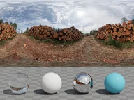</a> <b><a href="barnaslingan_01">Barnaslingan 01</a></b> by Savva Zakharov · <a href="https://polyhaven.com/a/barnaslingan_01">source</a> | <a href="barnaslingan_02">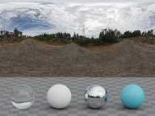</a> <b><a href="barnaslingan_02">Barnaslingan 02</a></b> by Savva Zakharov · <a href="https://polyhaven.com/a/barnaslingan_02">source</a> | <a href="brick_factory_02">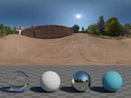</a> <b><a href="brick_factory_02">Brick Factory 02</a></b> by Sergej Majboroda · <a href="https://polyhaven.com/a/brick_factory_02">source</a> | <a href="construction_yard">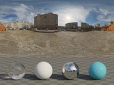</a> <b><a href="construction_yard">Construction Yard</a></b> by Sergej Majboroda · <a href="https://polyhaven.com/a/construction_yard">source</a> |
| <a href="factory_yard">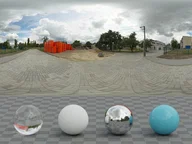</a> <b><a href="factory_yard">Factory Yard</a></b> by Sergej Majboroda · <a href="https://polyhaven.com/a/factory_yard">source</a> | <a href="freight_station">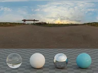</a> <b><a href="freight_station">Freight Station</a></b> by Sergej Majboroda · <a href="https://polyhaven.com/a/freight_station">source</a> | <a href="future_parking">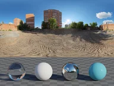</a> <b><a href="future_parking">Future Parking</a></b> by Sergej Majboroda · <a href="https://polyhaven.com/a/future_parking">source</a> | <a href="hangar_interior">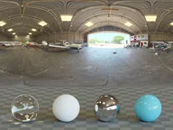</a> <b><a href="hangar_interior">Hangar Interior</a></b> by Dimitrios Savva, Jarod Guest · <a href="https://polyhaven.com/a/hangar_interior">source</a> |
| <a href="hanger_exterior_cloudy">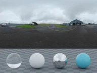</a> <b><a href="hanger_exterior_cloudy">Hanger Exterior Cloudy</a></b> by Dimitrios Savva, Jarod Guest · <a href="https://polyhaven.com/a/hanger_exterior_cloudy">source</a> | <a href="industrial_pipe_and_valve_01">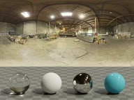</a> <b><a href="industrial_pipe_and_valve_01">Industrial Pipe & Valve 01</a></b> by Philip Modin · <a href="https://polyhaven.com/a/industrial_pipe_and_valve_01">source</a> | <a href="industrial_pipe_and_valve_02">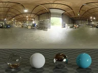</a> <b><a href="industrial_pipe_and_valve_02">Industrial Pipe & Valve 02</a></b> by Philip Modin · <a href="https://polyhaven.com/a/industrial_pipe_and_valve_02">source</a> | <a href="interior_construction">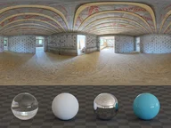</a> <b><a href="interior_construction">Interior Construction</a></b> by Sergej Majboroda · <a href="https://polyhaven.com/a/interior_construction">source</a> |
| <a href="minedump_flats">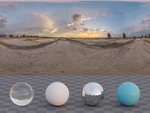</a> <b><a href="minedump_flats">Minedump Flats</a></b> by Dimitrios Savva, Jarod Guest · <a href="https://polyhaven.com/a/minedump_flats">source</a> | <a href="small_hangar_01">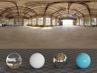</a> <b><a href="small_hangar_01">Small Hangar 01</a></b> by Sergej Majboroda · <a href="https://polyhaven.com/a/small_hangar_01">source</a> | <a href="small_hangar_02">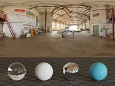</a> <b><a href="small_hangar_02">Small Hangar 02</a></b> by Sergej Majboroda · <a href="https://polyhaven.com/a/small_hangar_02">source</a> | <a href="sunset_in_the_chalk_quarry">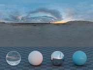</a> <b><a href="sunset_in_the_chalk_quarry">Sunset in the Chalk Quarry</a></b> by Sergej Majboroda · <a href="https://polyhaven.com/a/sunset_in_the_chalk_quarry">source</a> |
| <a href="unfinished_office">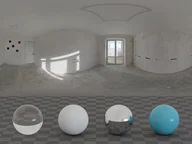</a> <b><a href="unfinished_office">Unfinished Office</a></b> by Sergej Majboroda · <a href="https://polyhaven.com/a/unfinished_office">source</a> | <a href="unfinished_office_night">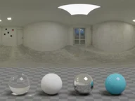</a> <b><a href="unfinished_office_night">Unfinished Office Night</a></b> by Sergej Majboroda · <a href="https://polyhaven.com/a/unfinished_office_night">source</a> |  |  |

---

Updated automatically by [cc0-mirror](https://github.com/zuujis-cc0/cc0-mirror). Something wrong? [Open an issue there](https://github.com/zuujis-cc0/cc0-mirror/issues/new) or use the [private report form](https://games.zuujis.com/report).
